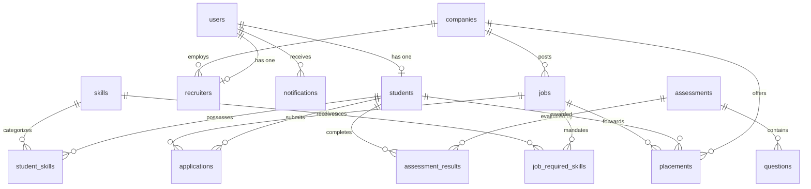

# SkillTrack - System Architecture & Technical Specifications

This document details the engineering specifications, data models, algorithm formulas, and security boundaries of **SkillTrack – Student Skill & Placement Management Platform**.

---

## 1. High-Level Architecture

SkillTrack uses a strictly decoupled full-stack architecture:

```
┌─────────────────────────────────────────────────────────────┐
│                    CLIENT BROWSER (SPA)                     │
│               React 18 + Vite + Bootstrap 5                 │
│         Chart.js • Font Awesome • Context Auth Provider     │
└──────────────────────────────┬──────────────────────────────┘
                               │
                       HTTP / REST APIs
                     JSON / JWT Bearer Token
                               │
                               ▼
┌─────────────────────────────────────────────────────────────┐
│                   BACKEND REST API SERVER                   │
│                     Node.js + Express                       │
│  ├── Authentication & RBAC Guards (authMiddleware)          │
│  ├── Document Parsing Engine (pdf-parse, mammoth)           │
│  ├── NLP Skill Recognition Engine (skillExtractorService)   │
│  ├── Placement Readiness Engine (readinessService)          │
│  └── Real-Time Eligibility Matcher (eligibilityService)     │
└──────────────────────────────┬──────────────────────────────┘
                               │
                         Sequelize ORM
                         MySQL2 Engine
                               │
                               ▼
┌─────────────────────────────────────────────────────────────┐
│                    RELATIONAL DATABASE                      │
│                          MySQL 8.0                          │
│     14 Normalized Tables • Foreign Keys • Cascading Deletes │
└─────────────────────────────────────────────────────────────┘
```

---

## 2. Entity-Relationship Diagram (ERD)



---

## 3. Placement Readiness Score Algorithm

The platform computes an indicative **Placement Readiness Score** out of 100 points:

$$
\text{Readiness Score} = S_{\text{tech}} + S_{\text{apt}} + S_{\text{comm}} + S_{\text{acad}}
$$

### Component Breakdown

1. **Technical Skills (35% Weight - Max 35 Points):**
   - Combines student online technical assessment scores (65% sub-weight) with self-reported/extracted verified skill proficiencies (35% sub-weight).
   - Proficiency ratings: Beginner (40%), Intermediate (70%), Advanced (90%), Expert (100%).

2. **Aptitude Assessments (25% Weight - Max 25 Points):**
   - Arithmetic reasoning, permutations, data interpretation, and analytical logic test scores.

3. **Communication Skills (20% Weight - Max 20 Points):**
   - Verbal assessments and workplace communication quizzes (60% sub-weight) combined with soft skill endorsements (40% sub-weight).

4. **Academic Standing (20% Weight - Max 20 Points):**
   - Scaled from current CGPA:

$$
S_{\text{acad}} = \max\left(0, \frac{\text{CGPA}}{10} \times 20 - (\text{Backlogs} \times 1.0)\right)
$$

### Readiness Categories
- **80 – 100:** Excellent (High placement probability)
- **60 – 79:** Good (Ready for tier-1 & tier-2 drives)
- **40 – 59:** Average (Targeted practice needed in weak components)
- **Below 40:** Needs Improvement (Requires intervention and skill-building)

---

## 4. Resume NLP Skill Extraction Pipeline

```
Candidate Resume (.pdf / .docx)
             │
             ▼
Document Text Extractor (pdf-parse / mammoth)
             │
             ▼
Regular Expression Clean & Heuristic Section Splitter
             │
             ▼
Pattern Matching against Multi-Tier Skill Dictionary:
  ├── Programming Languages (Python, JS, Java, C++, TypeScript, ...)
  ├── Frameworks & Libraries (React, Node, Express, Django, ...)
  ├── Databases (MySQL, PostgreSQL, MongoDB, Redis, ...)
  ├── Cloud & Developer Tools (Docker, AWS, Git, Linux, ...)
  └── Soft Skills (Communication, Problem Solving, Agile, ...)
             │
             ▼
Candidate Interactive Review UI (Student confirms / adjusts proficiency)
             │
             ▼
Database Commit to student_skills Table
             │
             ▼
Automatic Placement Readiness Score Recalculation
```

---

## 5. Security & Authorization Architecture

- **Password Hashing:** Passwords are encrypted using `bcryptjs` with 10 salt rounds.
- **JWT Authentication:** Tokens signed with HMAC-SHA256 containing user ID, email, and role, expiring in 7 days.
- **Role-Based Access Control (RBAC):** Middleware checks `req.user.role` before allowing route execution (`student`, `admin`, `recruiter`).
- **File Upload Security:** Multer checks MIME types (`application/pdf`, `.docx`) and limits files to 10MB with sanitized filenames.
- **Data Validation:** Strict sanitization against SQL injection via parameterized Sequelize ORM queries.

